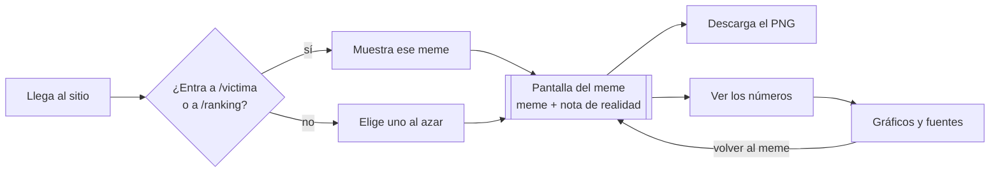
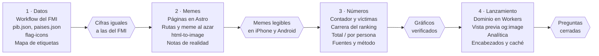

# PRD · La Remontada

25 de octubre de 2026 · Jesús

## Resumen

La Remontada es un sitio de humor en `laremontada.vanguarddevs.com` que convierte el ascenso de Venezuela en el ranking mundial de PIB en memes que se actualizan solos con los datos. Al entrar, el visitante ve uno de dos memes al azar, lo descarga y lo comparte; si toca "Ver los números", ve los gráficos y las fuentes que lo respaldan.

- **Público:** venezolanos en redes (sobre todo X) que siguen el meme de "próxima víctima", y los "hermanos latinoamericanos" que responden con cope.
- **Inspiración:** el post de @rapaccious "Ya pasamos el PIB de Croacia. Próxima víctima: Guatemala." y la respuesta de @aranguve pidiendo un gráfico del ranking mes a mes (captura en `docs/referencia/inspiracion-tweet.png`).
- **Tono:** se celebra la remontada y, en la misma pantalla, una nota de realidad corta dice lo que el meme no dice. El sitio se ríe primero de sí mismo.

## Objetivos y métricas

El éxito se mide en memes descargados y compartidos, no en tiempo dentro del sitio.

| Objetivo | Métrica | Cómo se mide |
| --- | --- | --- |
| Que el meme circule | Descargas por meme | Evento en Cloudflare Zaraz al tocar "Descargar meme", si se decide contarlas |
| Que lo compartido traiga gente | Visitas que entran directo a `/victima` o `/ranking` | Cloudflare Web Analytics, por ruta |
| Que los números respalden el chiste | Visitas a `/victima/numeros` y `/ranking/numeros` | Cloudflare Web Analytics, por ruta |
| Que el sitio cargue rápido en el celular | Tiempo hasta ver el meme | Cloudflare Web Analytics (Core Web Vitals) |

Las metas numéricas de cada métrica quedan por definir (ver Preguntas abiertas).

## Alcance

La v1 trae dos memes que se arman solos con los datos, su descarga y una sección de números por meme.

**Entra en v1**

- Meme "La muerte tocando puertas" con etiquetas y banderas generadas desde los datos.
- Meme "La escalera de medallas" con etiquetas y banderas generadas desde los datos.
- Un meme al azar al entrar a `/`, sin botón para cambiarlo.
- Una ruta por meme, `/victima` y `/ranking`, cada una con su propia vista previa para X.
- Botón "Descargar meme" que baja un PNG con las etiquetas, las banderas y la dirección del sitio.
- Nota de realidad debajo de cada meme.
- Una página de números por meme: `/victima/numeros` y `/ranking/numeros`.
- Datos del FMI incluidos en el sitio y banderas de `flag-icons`.

**Queda fuera de v1**

- El simulador "¿Cuándo pasamos a…?".
- Video MP4 automático de la carrera del ranking (queda para más adelante).
- Memes adicionales (el cementerio, el Copiómetro, el Arepómetro).
- Un generador de memes con texto libre.
- Versión en inglés.
- Base de datos, cuentas de usuario, comentarios o cualquier dato guardado de los visitantes.

## Experiencia de usuario

El visitante ve un meme listo para descargar en el primer pantallazo, sin menús ni portada.



Volver desde los gráficos regresa a la ruta del mismo meme, no a `/`.

**Reglas de llegada**

- En `/`: un script en el `<head>` elige uno de los dos memes al azar, con la misma probabilidad, antes de pintar la pantalla. Así no hay parpadeo de un meme a otro.
- En `/victima` o `/ranking`: muestra ese meme, siempre. Un link compartido nunca muestra otra cosa.
- No hay botón "Otro meme". Para ver el otro, el visitante recarga `/` o entra a su ruta.

**Pantalla del meme (de arriba abajo)**

1. Nombre del sitio, en pequeño.
2. El meme con sus etiquetas, ocupando el ancho de la pantalla en el celular.
3. Botón "Descargar meme".
4. Nota de realidad, una o dos líneas en letra más pequeña.
5. Botón "Ver los números".
6. Pie: "Sitio de humor" y enlace a las fuentes.

**Pantalla de números** (`/victima/numeros` y `/ranking/numeros`): el meme en pequeño arriba, luego el gráfico, 2 o 3 líneas de qué significan, las fuentes y "Volver al meme", que lleva a la ruta del mismo meme y no a uno al azar.

## Requisitos funcionales

Cada meme es la imagen base con etiquetas HTML encima (bandera + texto + PIB total), armadas con los datos al compilar. La descarga fotografía ese mismo HTML, así que lo que se ve es lo que se baja, y el meme se actualiza solo cuando cambia el ranking.

### Meme 1 · La muerte tocando puertas (`/victima`)

| Lugar en la imagen | Qué lleva | De dónde sale |
| --- | --- | --- |
| Puertas 1 a 4 (ensangrentadas, de izquierda a derecha) | Bandera + nombre + PIB total | Las víctimas 5.ª a 2.ª más recientes |
| Puerta 5 (abierta, junto a la muerte) | Bandera + nombre + PIB total | La última víctima |
| Puerta 6 (donde toca) | Bandera + nombre + PIB total + "PRÓXIMA VÍCTIMA" | El país justo encima de Venezuela |
| La muerte | Bandera de Venezuela en la túnica | Fija |

- **Víctima** = país que estaba por encima de Venezuela en la fecha de inicio y hoy está por debajo. La fecha de inicio se configura en un solo lugar (propuesta: enero de 2026).
- Si hay menos de 5 víctimas, las puertas sobrantes toman los países que siguen por debajo.
- El PIB total va debajo del nombre, con la cifra estándar: "$124,2 mil M".
- Nota de realidad (plantilla con datos): "Pasamos a {última víctima} en PIB total. En PIB por persona, {última víctima} produce {N} veces más que Venezuela."

### Meme 2 · La escalera de medallas (`/ranking`)

La imagen tiene 12 personajes: 10 en los escalones de arriba, el que celebra y 1 abajo.

| Lugar en la imagen | Qué lleva | De dónde sale |
| --- | --- | --- |
| Personaje de arriba (rojo) | Bandera + "#1" + PIB total | El primer país del ranking |
| Los 9 siguientes | Bandera + su puesto + PIB total | Los 9 países justo encima de Venezuela |
| El que celebra | Bandera + "#{puesto}" grande + "VENEZUELA" + PIB total | Puesto actual de Venezuela |
| El de abajo | Bandera + su puesto + PIB total | La última víctima |

- El PIB total va debajo del puesto, en formato compacto de mil millones: "$112 MM".
- Nota de realidad (plantilla con datos): "Puesto {puesto} en PIB total, pero puesto {puesto per cápita} de {total} en PIB por persona."

### Etiquetas y descarga

- Cada etiqueta es un bloque HTML con `position: absolute` sobre la imagen, ubicado en porcentajes (izquierda, arriba, ancho) para que escale igual en cualquier pantalla.
- Las posiciones viven en un archivo por meme (`memes/puertas.json`, `memes/escalera.json`) que Astro lee al compilar. Hay una primera calibración en este paquete.
- Bandera: clase de `flag-icons` (`fi fi-ve`). El sitio sirve la bandera como WebP generado de esos SVG (128×96), para que un SVG pesado no compita con la imagen del meme. Texto: letra estilo meme, blanca con borde negro, en Anton (autoalojada). Se achica sola si el nombre no cabe.
- El PIB total de cada etiqueta sale de `data/` para el mes actual; la escalera lo abrevia en "MM" y las puertas usan la cifra estándar.
- "Descargar meme" convierte el bloque del meme en PNG con `html-to-image`, al tamaño original de la imagen (ajustando `pixelRatio`), con `laremontada.vanguarddevs.com` en una esquina.
- Antes de capturar se espera a `document.fonts.ready`. En Safari se captura dos veces y se usa la segunda, porque la primera puede salir con imágenes en blanco.
- Respaldo, si las pruebas en iPhone fallan: redibujar en un `canvas` con el mismo archivo de posiciones.
- Nombre del archivo: `laremontada-{meme}-{AAAA-MM-DD}.png`.
- Los nombres son texto real, así que los lectores de pantalla los leen; la imagen base lleva un texto alternativo corto.

### Ver los números

**En `/victima/numeros`:**

- Contador del PIB de Venezuela que sube cada segundo según la estimación del día.
- Gráfico "Las líneas que se cruzan" (ver Gráficos).
- Lista de víctimas con el mes en que cayó cada una.

**En `/ranking/numeros`:**

- Gráfico "La carrera del ranking" (ver Gráficos).
- Tabla con los mismos datos debajo, para quien no quiera o no pueda ver la animación.

**En ambas:** fuentes y método, la aclaración de que es un sitio de humor y "Volver al meme".

## Gráficos

Hay dos gráficos, uno por página de números: la carrera del ranking desde enero de 2020 hasta hoy más seis meses de proyección, y las líneas que se cruzan con la próxima víctima.

### La carrera del ranking (`/ranking/numeros`)

```
                                   Mar 2026
 70  [GT] Guatemala      ████████████████  $121 mil M
 71  [HR] Croacia        ███████████████   $119 mil M
 72  [VE] VENEZUELA      ███████████████   $118 mil M   <- en color
 73  [OM] Omán           ██████████████    $117 mil M
 [>]  o===================o-----------   ene 2020 ... hoy + 6 meses
                         hoy   proyección
```

Boceto con cifras de ejemplo; los valores reales salen de `data/pib.json`.

| Aspecto | Decisión |
| --- | --- |
| Rango | Enero de 2020 hasta el mes actual, más los 6 meses siguientes como proyección. El final se mueve solo cada mes (hoy: enero 2020 a abril 2027, 88 meses) |
| Duración | Unos 20 segundos por vuelta completa (unos 230 ms por mes), ajustable en un solo lugar |
| Países visibles | 11 en celular, 15 en escritorio, con Venezuela siempre en el centro de la ventana |
| Color | Venezuela es la única barra en color (`--amarillo`); el resto en `--barra` |
| Etiquetas | Puesto, bandera de `flag-icons`, nombre corto y valor en miles de millones de dólares |
| Movimiento | Las barras crecen de forma continua entre meses y se reordenan con una transición suave al adelantarse |
| Caídas | Cuando Venezuela pasa a un país, la animación se pausa 0,5 s y aparece "Cae {país} · {mes año}". Solo se avisan los adelantos de Venezuela |
| Proyección | Los meses posteriores a hoy van con barras rayadas y la etiqueta "proyección" junto al mes |
| Controles | Reproducir/pausar, barra de tiempo para saltar a cualquier mes, botón "PIB total / PIB por persona" |
| Al cargar | Arranca quieta en el mes actual; la animación empieza al tocar reproducir |
| Movimiento reducido | Con `prefers-reduced-motion`, sin animación: la barra de tiempo cambia el mes de golpe |

### Las líneas que se cruzan (`/victima/numeros`)

- Dos líneas mes a mes: el PIB de Venezuela (en color) y el de la próxima víctima (en gris), desde enero de 2026 hasta la fecha del cruce o 6 meses después de hoy, lo que llegue más tarde.
- El punto donde se cruzan se marca con una calavera y la fecha estimada: "Cae {país} · {mes año}".
- Si con los datos actuales no hay cruce dentro de la proyección, el gráfico lo dice: "Al ritmo actual, {país} resiste más allá de {mes año}".

### Cómo se construyen

- D3, solo los módulos de escalas y transiciones, dentro de una isla de Astro.
- SVG para barras y líneas; banderas en HTML con `flag-icons`, como en los memes.
- La serie mensual llega calculada desde la compilación; el navegador solo anima.
- Debajo de cada gráfico: "Datos: FMI, {edición}. Estimación mensual a partir de las proyecciones anuales."

## Datos

Todos los números salen de una sola fuente, el FMI, y viajan dentro del sitio como archivos estáticos; nada se consulta a terceros mientras alguien navega.

### Qué se incluye

| Archivo | Contenido | Fuente | Peso aproximado |
| --- | --- | --- | --- |
| `data/pib.json` | PIB en dólares corrientes y PIB por persona, por país y año, 2019–2027 (2019 hace falta para estimar enero a junio de 2020) | FMI, World Economic Outlook, octubre 2026 | menos de 100 KB |
| `data/paises.json` | Código ISO, nombre en español, nombre corto para etiquetas | Lista propia | menos de 20 KB |
| `flag-icons` (npm) | Una bandera por país como clase CSS (`fi fi-ve`), formato 4:3 | [lipis/flag-icons](https://github.com/lipis/flag-icons), licencia MIT | el navegador baja solo las visibles, rasterizadas a WebP |
| `memes/puertas.jpg`, `memes/escalera.jpg` | Las dos imágenes base | El dueño del sitio | 54 KB y 104 KB |
| `memes/*.json` | Posición de cada etiqueta en cada imagen, en porcentajes | Lista propia | menos de 5 KB |

- Edición a usar: [World Economic Outlook de octubre 2026](https://www.imf.org/en/publications/weo/issues/2026/10/13/world-economic-outlook-october-2026), publicada el 13 de octubre de 2026. Es más reciente que la de abril (la que pone a Venezuela en el puesto 78 con $111,3 mil millones).
- Se incluyen los unos 190 países del FMI. Los que no tienen dato en algún año quedan fuera del ranking de ese año.

### Cómo se calcula el mes a mes

1. El valor anual del FMI se ubica a mitad de cada año (1 de julio).
2. Entre dos años seguidos, el valor de cada mes se calcula con crecimiento constante (curva suave, no línea recta).
3. Con esos valores mensuales se arma el ranking de cada mes, se fecha cada víctima y se mueve el contador en vivo.
4. Los meses posteriores a hoy se muestran como proyección, con un estilo distinto.

En la sección de fuentes va una línea: "Estimación mensual a partir de las proyecciones anuales del FMI. No es un dato oficial mensual."

### Actualización

- El FMI publica dos veces al año, en abril y en octubre.
- Un workflow de GitHub Actions (manual o programado para abril y octubre) descarga el archivo del FMI, lo valida (unos 190 países, Venezuela presente, sin saltos absurdos) y abre un Pull Request con un resumen: "Venezuela pasa del puesto X al Y; nueva próxima víctima: Z".
- Al aprobar el Pull Request, Cloudflare publica solo.
- Un cron mensual (día 1) recompila el sitio, para que el meme cambie cuando cae un país. Las series son mensuales, así que el ranking no cambia entre dos meses.
- El archivo crudo de cada edición del FMI se guarda en MEGA S4, para poder rehacer cualquier número.
- El sitio muestra la edición que usa ("Datos: FMI, octubre 2026") debajo de cada gráfico.

## Requisitos técnicos

Es un sitio estático en Cloudflare Workers (assets estáticos): sin servidor propio, sin base de datos y sin cuentas.

| Tema | Decisión |
| --- | --- |
| Hosting | Cloudflare Workers con assets estáticos (`wrangler.jsonc`), conectado al repositorio de GitHub; cada cambio en la rama principal publica solo. Un deploy hook, llamado por GitHub Actions, recompila sin necesidad de un commit |
| Dominio | `laremontada.vanguarddevs.com` como dominio propio del proyecto de Pages (registro CNAME en la zona `vanguarddevs.com`) |
| Framework | Astro en modo estático: cada ruta es una página HTML generada al compilar |
| Rutas | `/` (meme al azar), `/victima`, `/ranking`, `/victima/numeros`, `/ranking/numeros` |
| Meme al azar | Script en línea en el `<head>` de `/` que elige el meme antes de pintar |
| Memes | Imagen base + etiquetas HTML posicionadas en porcentajes; banderas con `flag-icons` servidas en WebP |
| Descarga | `html-to-image` (`toPng`); respaldo con `canvas` |
| Gráficos | Islas de Astro que cargan su JavaScript solo en las páginas de números |
| Base de datos | Ninguna |
| Automatización | GitHub Actions: datos del FMI con Pull Request, recompilación mensual, capturas con Playwright para la vista previa y prueba visual a ancho de celular |
| Archivo | MEGA S4 guarda los datos crudos de cada edición del FMI y la captura de cada meme en cada recompilación. No sirve archivos al sitio |
| Fuentes | Autoalojadas (descargadas de Google Fonts); la descarga espera a que carguen |
| Analítica | Cloudflare Web Analytics por ruta; descargas con Cloudflare Zaraz si se decide contarlas |
| Vista previa al compartir | `og:image` y `twitter:card` propias de cada ruta, con la captura de Playwright. El build de Cloudflare no trae Chromium: las capturas se generan en GitHub Actions y se versionan en `public/og/` |
| Encabezados | Archivo `_headers` con política de seguridad de contenido y caché larga para archivos versionados; caché corta para `data/` |
| Secretos | Credenciales de MEGA S4 y la URL del deploy hook (`CF_DEPLOY_HOOK`) solo en los secretos de GitHub Actions, nunca en el repositorio |

**Rendimiento**

- El meme se ve en menos de 2 segundos en un celular con 4G.
- La primera pantalla pesa menos de 600 KB: imagen base optimizada (WebP), CSS propio de banderas y solo las banderas visibles.
- Las páginas de meme casi no llevan JavaScript; el de los gráficos se carga solo en las páginas de números.

**Compatibilidad**

- Las dos últimas versiones de Chrome, Safari, Firefox y Edge, y Safari en iPhone desde iOS 15.
- Diseño pensado primero para celular (unos 400 px de ancho); en escritorio el meme no pasa de unos 720 px.
- En iPhone, la descarga abre la imagen para guardarla; es el comportamiento normal de Safari.
- El tamaño de letra de las etiquetas usa unidades `cqw` (consultas de contenedor), que Safari soporta desde iOS 16. Para iOS 15, calcular el tamaño con un `ResizeObserver` que fije una variable CSS con el ancho del meme.

## Contenido y tono

El chiste es la situación y el cope; nunca la gente de otro país.

**Reglas de humor**

- Los países aparecen como "víctimas" de un ranking, no como blanco de burlas sobre su gente, su cultura o sus problemas.
- Nada de capturas falsas de cuentas reales ni de Grok. Si hace falta una voz, es un personaje inventado ("el primo que se fue en 2017").
- Las cifras de los memes y las notas salen siempre de los datos; ningún número se escribe a mano.

**Notas de realidad**

- Van debajo del meme, en una o dos líneas y en letra más pequeña que el meme.
- Dicen lo que el meme no dice, con un dato: el PIB por persona, el puesto per cápita, la distancia con 2014.
- Tono seco, sin moraleja.

**Textos fijos del sitio**

| Lugar | Texto propuesto |
| --- | --- |
| Pie de página | "Sitio de humor. Los números son reales; la euforia, no tanto." |
| Botón de descarga | "Descargar meme" |
| Botón a los gráficos | "Ver los números" |
| Botón de regreso | "Volver al meme" |
| Método | "Estimación mensual a partir de las proyecciones anuales del FMI. No es un dato oficial mensual." |

**Imágenes base**

Las dos plantillas son memes que circulan desde hace años y se usan tal cual con texto encima. Antes de publicar, conviene confirmar el origen de cada imagen y dar crédito al autor si se conoce.

## Identidad visual

El sitio se viste de billete de bolívar: papel con tramas grabadas, sellos y letra pequeña, con los tres colores de la bandera. El marco es sobrio y los memes son lo único ruidoso. La ironía es el punto: la remontada se presenta con la estética del dinero que perdió su valor.

### Concepto en tres piezas

- **El billete.** Fondo color papel moneda, tramas de guilloché (líneas onduladas entrelazadas) solo en el encabezado y el pie, y un borde doble alrededor del meme, como el marco de un billete.
- **La letra pequeña.** La nota de realidad se presenta como la letra pequeña del billete, sin etiqueta propia. Es el lugar natural del dato incómodo.

### Marca

| Elemento | Definición |
| --- | --- |
| Nombre | La Remontada |
| Lema | "Puesto {n} y subiendo." Se genera con los datos |
| Isotipo | El arco de las 8 estrellas de la bandera, dibujado como una curva que sube de izquierda a derecha; la última estrella es más grande. Es la remontada en una forma |
| Logotipo | "LA REMONTADA" en la fuente de títulos, peso 800, con el isotipo encima de la palabra REMONTADA |
| Favicon | Solo el isotipo, en azul sobre amarillo |
| Sellos | "PROYECCIÓN" (sobre los meses estimados) y "CAÍDA" (en el aviso de cada víctima): texto en rojo, borde doble, girado unos -6°, como sello de goma |
| Marca de agua del meme descargado | Isotipo + `laremontada.vanguarddevs.com` en Martian Mono, blanco al 85% con sombra; la esquina se define en cada `memes/*.json` |

No se usa el escudo nacional, ni logos o nombres de bancos reales.

### Paleta

| Token | Claro | Oscuro | Uso |
| --- | --- | --- | --- |
| `--papel` | #EDF0E6 | #0F1621 | Fondo de la página (papel moneda; de noche, tinta) |
| `--papel-2` | #E2E7D9 | #172130 | Superficies: tarjetas, tabla, barra de controles |
| `--tinta` | #1B2738 | #E7EBE1 | Texto principal |
| `--tinta-suave` | #56627A | #9BA6B8 | Texto secundario, ejes, letra pequeña |
| `--guilloche` | #A8BBA9 | #2D4650 | Tramas, líneas de cuadrícula, bordes finos |
| `--amarillo` | #F2C12E | #F5CC4E | Barra de Venezuela, botón principal, línea de Venezuela |
| `--azul` | #1E3F8C | #7C9CF2 | Enlaces, foco del teclado, isotipo |
| `--rojo` | #C3302B | #F0695C | Sellos, aviso de caída, puertas en la lista de víctimas |
| `--barra` | #A3ABB4 | #4A5566 | Barras y líneas de los demás países |

- El amarillo nunca va como color de texto sobre papel; lleva texto en `--tinta` encima.
- Venezuela es lo único amarillo en los gráficos. Las demás barras van en `--barra`.
- La proyección se dibuja con rayas diagonales de 45° del mismo color de la barra, al 50%.
- El tema sigue `prefers-color-scheme`; no hace falta botón de cambio de tema.

### Tipografía (autoalojada, de Google Fonts)

| Rol | Fuente | Uso | Respaldo |
| --- | --- | --- | --- |
| Títulos y cifras grandes | Big Shoulders Display, 700–900 | Logotipo, "Puesto 72", mes de la carrera, encabezados | `Impact, "Arial Narrow", sans-serif` |
| Texto | Atkinson Hyperlegible, 400 y 700 | Párrafos, botones, notas | `system-ui, sans-serif` |
| Datos | Martian Mono, 400–600 | Contador, valores de barras | `ui-monospace, monospace` |
| Etiquetas del meme | Anton, 400 | Solo el texto sobre las imágenes, blanco con borde negro | `Impact, sans-serif` |

Escala (celular → escritorio): 12 · 14 · 16 · 20 · 28 · 40 · 64 px. Cifras siempre con `font-variant-numeric: tabular-nums`. Etiquetas en mayúsculas con `letter-spacing: 0.08em`.

### Componentes

| Componente | Estilo |
| --- | --- |
| Botón "Descargar meme" | Fondo `--amarillo`, texto tinta oscura en Atkinson 700, borde 2 px `--tinta`, radio 4 px, sombra sólida desplazada 3 px abajo a la derecha. Al presionarlo, la sombra desaparece y el botón baja 3 px, como un sello |
| Botón "Ver los números" | Solo borde 2 px `--tinta`, fondo transparente, flecha → al final |
| Marco del meme | Doble línea `--guilloche` (1 px, 4 px de separación, 1 px). El marco no sale en la descarga |
| Letra pequeña | Texto en Atkinson 14 px, sin etiqueta. Ancho máximo de unos 60 caracteres |
| Aviso de caída | Sello rojo "CAÍDA" + "Cae Croacia · marzo 2026", sobre `--papel-2` |
| Encabezado | Logotipo a la izquierda, franja de guilloché de 24 px debajo |
| Pie | Franja de guilloché, "Sitio de humor. Los números son reales; la euforia, no tanto." enlace a las fuentes y una línea de créditos a vanguarddevs.com ("Hecho por vanguarddevs.com. Ningún economista fue consultado; dos cafés, sí.") |

### Movimiento

- Al cargar, el puesto del lema gira como un contador mecánico hasta su número, una sola vez y en menos de 1 s.
- El sello de caída entra de golpe: de 130% a 100% de tamaño con un giro, en 200 ms.
- No hay más animaciones fuera de los gráficos. Con `prefers-reduced-motion`, nada se mueve.

### Tokens para el código

Los tokens completos, con los estilos base de botones, marco, letra pequeña y sellos, están en `src/styles/tokens.css`.

```css
:root {
  --papel: #EDF0E6; --papel-2: #E2E7D9; --tinta: #1B2738; --tinta-suave: #56627A;
  --guilloche: #A8BBA9; --amarillo: #F2C12E; --azul: #1E3F8C; --rojo: #C3302B; --barra: #A3ABB4;
  --f-titulo: "Big Shoulders Display", Impact, "Arial Narrow", sans-serif;
  --f-texto: "Atkinson Hyperlegible", system-ui, sans-serif;
  --f-datos: "Martian Mono", ui-monospace, monospace;
  --f-meme: "Anton", Impact, sans-serif;
  --radio: 4px;
}
@media (prefers-color-scheme: dark) {
  :root {
    --papel: #0F1621; --papel-2: #172130; --tinta: #E7EBE1; --tinta-suave: #9BA6B8;
    --guilloche: #2D4650; --amarillo: #F5CC4E; --azul: #7C9CF2; --rojo: #F0695C; --barra: #4A5566;
    color-scheme: dark;
  }
}
body { background: var(--papel); color: var(--tinta); font-family: var(--f-texto); }
```

## Riesgos y preguntas abiertas

El riesgo mayor es que los números del sitio no coincidan con los que circulan en X y alguien "corrija" el meme.

| Riesgo | Qué pasa | Cómo se cubre |
| --- | --- | --- |
| El puesto no coincide con el del tweet | El tweet dice puesto 72; el FMI de abril decía 78 | Cada gráfico muestra la edición del FMI y el método |
| La próxima víctima no es Guatemala | Con los datos de octubre puede ser otro país | El meme toma el nombre de los datos, no de un texto fijo |
| Venezuela baja en el ranking | Una devaluación o una caída del petróleo cambia el PIB en dólares | Las puertas usan el respaldo definido (países por debajo) y el meme sigue funcionando |
| Se citan las cifras del BCV | El BCV reporta 7,14% en el segundo trimestre; el FMI proyecta menos | La sección de fuentes explica que el sitio usa solo al FMI |
| La descarga falla en Safari | `html-to-image` a veces captura imágenes en blanco la primera vez | Doble captura, respaldo con `canvas` y prueba en iPhone antes de lanzar |
| Etiquetas ilegibles en celular | La escalera tiene 12 personajes y las puertas del fondo son pequeñas | Bandera + puesto + PIB compacto en los 11 personajes de la escalera; en la descarga (tamaño original) se leen bien |
| Uso de las imágenes | Son memes de autoría poco clara | Confirmar origen y dar crédito antes de publicar |

**Preguntas abiertas**

- [ ] ¿Desde qué fecha se cuentan las víctimas del meme de las puertas? Propuesta: enero de 2026.
- [ ] ¿Se cuentan las descargas con Cloudflare Zaraz o se dejan fuera de la v1?
- [ ] ¿Qué metas numéricas tienen las métricas de éxito?
- [ ] En celular, ¿el botón de descarga también ofrece "Compartir" cuando el navegador lo permite?
- [x] ¿Se aprueba la identidad visual del billete propuesta en Identidad visual?
- [ ] ¿Quién es el autor de cada imagen base y cómo se le da crédito?

## Plan de entrega

Se entrega en cuatro fases; ninguna empieza hasta que la anterior pasa su revisión.



La fase 2 es la primera que se puede mostrar: un meme funcionando con datos reales sirve para validar cómo quedan las etiquetas antes de construir los gráficos.

## Guía para la implementación

Esta sección es el punto de partida para construir el sitio con Claude Code: estructura del repositorio, módulos y criterios de aceptación.

### Estructura del repositorio

```
laremontada/
├── src/
│   ├── pages/
│   │   ├── index.astro            # meme al azar
│   │   ├── victima/index.astro    # meme de las puertas
│   │   ├── victima/numeros.astro  # contador, líneas que se cruzan, víctimas
│   │   ├── ranking/index.astro    # meme de la escalera
│   │   └── ranking/numeros.astro  # carrera del ranking
│   ├── components/                # Meme, Etiqueta, NotaRealidad, BotonDescarga
│   ├── islands/                   # CarreraRanking, LineasCruce, Contador
│   ├── lib/                       # interpolar, ranking, victimas, notas
│   └── styles/tokens.css          # de estilos/tokens.css
├── data/                          # pib.json, paises.json
├── public/memes/                  # puertas.jpg, escalera.jpg
├── memes/                         # puertas.json, escalera.json (posiciones)
├── public/og/                     # og:image versionadas (las genera Actions)
├── scripts/                       # actualizar-fmi, capturas-og
└── .github/workflows/             # datos-fmi.yml, recompilar-mensual.yml
```

### Módulos de `src/lib`

| Módulo | Hace | Entrada → salida |
| --- | --- | --- |
| `interpolar` | Valor mensual con crecimiento constante entre dos valores anuales ubicados el 1 de julio | serie anual por país → serie mensual por país |
| `ranking` | Ordena los países por PIB total o por persona en un mes dado | serie mensual + mes → lista ordenada con puestos |
| `victimas` | Países que estaban por encima de Venezuela en la fecha de inicio y hoy están por debajo, con el mes del adelanto | rankings mensuales → lista de víctimas con fecha |
| `notas` | Rellena las plantillas de las notas de realidad | ranking del mes + víctimas → texto |

### Criterios de aceptación

- [ ] `/` muestra uno de los dos memes al azar, sin parpadeo entre uno y otro.
- [ ] `/victima` y `/ranking` muestran siempre su meme y tienen su propia `og:image`.
- [ ] Las etiquetas de ambos memes coinciden con el ranking calculado para el mes actual y muestran el PIB total de cada país: compacto en la escalera ("$112 MM"), estándar en las puertas ("$124,2 mil M").
- [ ] "Descargar meme" baja un PNG al tamaño original con banderas, texto y dirección del sitio en Chrome para Android y Safari para iPhone.
- [ ] La carrera va de enero de 2020 al mes actual más 6 meses, con la proyección rayada, el aviso de cada caída y el cambio entre PIB total y por persona.
- [ ] Con movimiento reducido, ningún gráfico se anima.
- [ ] Pruebas unitarias para `interpolar`, `ranking` y `victimas`.
- [ ] La primera pantalla pesa menos de 600 KB y el meme se ve en menos de 2 s en 4G.
- [ ] El workflow de datos abre un Pull Request con el resumen de cambios y no publica sin aprobación.

## Fuentes

- [FMI, World Economic Outlook, octubre 2026](https://www.imf.org/en/publications/weo/issues/2026/10/13/world-economic-outlook-october-2026)
- [Fermor: PIB de Venezuela según el FMI de abril 2026 (puesto 78)](https://fermor.in/gdp/venezuela)
- [Bloomberg Línea: el BCV reporta 7,14% de crecimiento en el segundo trimestre de 2026](https://www.bloomberglinea.com/economia/bcv-dice-que-el-pib-venezolano-aumento-714-en-el-segundo-trimestre-de-2026/)
- [lipis/flag-icons en GitHub](https://github.com/lipis/flag-icons)
- [Google Fonts](https://fonts.google.com/): Anton, Atkinson Hyperlegible, Big Shoulders Display y Martian Mono, SIL Open Font License 1.1 (autoalojadas)
